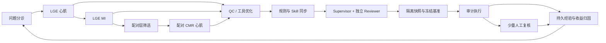

# CMR/LGE RSI

面向心脏 MRI 标签质控的多智能体闭环与递归自我改进（RSI）研究框架。

将**分诊 → 专家分析 → 工具/规则改进 → 独立评审 → 冻结基准验证 → 审计执行 → 经验回流**连接成可追踪的控制流程。角色上下文保存在本地数据库中，可在更换模型或 API 后继承。

这是数据脱敏后的研究软件发布。包含控制台、标签编辑器、通用 QC 工具、执行协议、基准基础设施和回归测试；不包含私人数据、真实病例记录、医生参考标签、校准产物或预训练权重。**本仓库不声称已证明持续的临床 RSI 性能提升。**

## 工作流



数据依赖按 LGE 心肌 → MI → 配对 CMR 推进；可执行队列采用公平调度，每例依赖仍独立检查。维护角色只改控制面，领域角色只在隔离快照中实现批准的动作。

## 快速开始：不调用付费 API

建议 Linux / WSL，Python 3.10–3.12。部分常驻控制器使用 `fcntl`、用户级 systemd 和 Linux 进程接口。

```bash
python3 -m venv .venv
source .venv/bin/activate
pip install -r requirements.txt
python scripts/create_demo.py
python cli.py init
python scripts/board_server.py --port 8765
```

打开 <http://127.0.0.1:8765/>。合成数据位于 `data/dataset`，编辑器演示入口：
<http://127.0.0.1:8765/editor?pool=cmr_middle_manifest&index=0&mode=manual>。

演示仅生成几何图形，不来自患者影像；默认角色使用 mock，自动执行与真实数据写入默认关闭。**看板可打开不等于真实自主 QC 已配置完成。**

## 接入自己的环境

1. 设置 `CMR_LGE_DATASET`、`CMR_LGE_PYTHON`（可选）和 `CMR_LGE_SKILL_ROOT`（可选）。默认 Skill 已随源码提供。
2. 按 [部署说明](docs/DEPLOYMENT.md) 配置本地密钥及用户级服务，再绑定有权限使用的数据。
3. 参考 `configs/quality_scoring_datasets.example.yaml` 配置自己的医生审核图像/标签对，重建校准与冻结基准。公开版不携带任何私有基准资产或有效晋级授权。
4. 配置 Provider 和角色模型，完成本地验证后显式启用 `configs/autonomy.json`、`configs/lge_execution.json` 并从 UI 启动有界工作流。
5. 通过待复核队列提供代表性人工示例，差分与验收结果进入持久经验链；新工具仍需独立验证。

API 密钥只从环境变量读取。模型适配器目前包括 mock 和 OpenAI-compatible Chat Completions；其他协议需要适配器，不能仅改接口地址。

## 验证

```bash
python -m unittest discover -s tests -q
python scripts/audit_public_tree.py
```

测试使用临时目录与合成样例，不需要真实患者数据或云 API。CI 执行同样的检查。回归测试通过只证明所覆盖的软件行为，不代表医学标注正确率。

## 目录

| 目录 | 内容 |
| --- | --- |
| `agents/` | 角色交接、证据汇总、实现评审 |
| `app/` | 状态机、执行控制、经验与 RSI 内核 |
| `providers/`、`contracts/` | API 适配与结构化契约 |
| `scripts/`、`static/` | 常驻服务、控制台和标签编辑器 |
| `experiments/` | 隔离实验与通用规则模块 |
| `skills/cmr-lge-label-qc-workflow/` | 通用确定性 QC 工具与流程说明 |
| `tests/` | 合成数据回归测试 |

[开源脱敏说明](docs/PUBLIC_RELEASE.md) · [隐私与部署安全](SECURITY.md) · [能力与限制](docs/STATUS.md) · [许可证](LICENSE)
