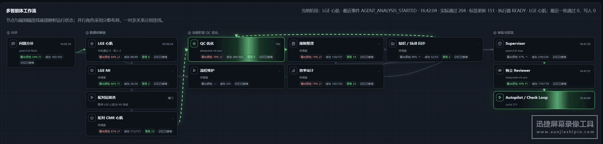
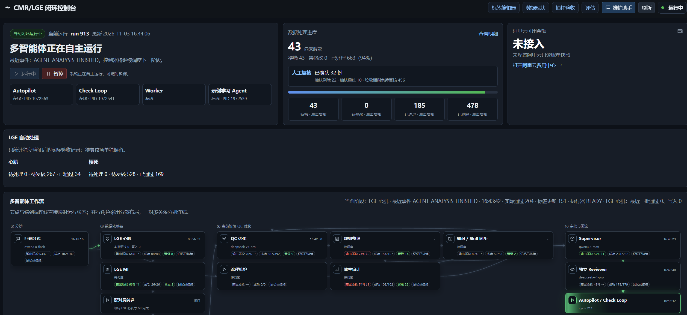
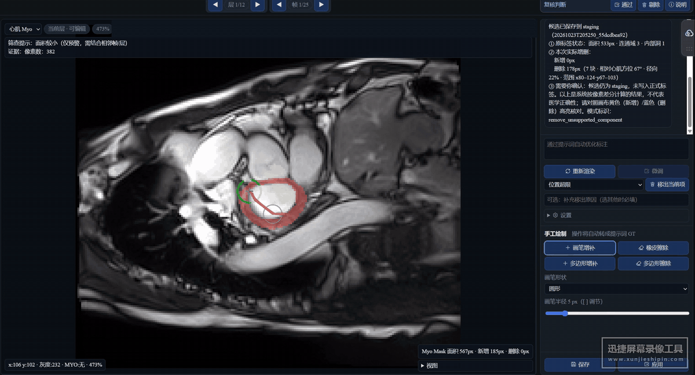

<div align="center">

# 🫀 CMR/LGE RSI

### Turn expert feedback into the next improvement cycle.

**Visual multi-agent workflows · Persistent role memory · Governed self-improvement** for cardiac MRI label quality control.

[](https://github.com/Oubit1/cmr-lge-rsi/actions/workflows/ci.yml) [](LICENSE) [](requirements.txt) [](app/agent_continuity.py)

[简体中文](README.zh-CN.md) · **English**

[Watch the demos](#watch-it-work) · [Highlights](#highlights) · [The improvement loop](#the-improvement-loop) · [Quick start](#quick-start) · [Deployment](docs/DEPLOYMENT.md)

</div>

[](https://github.com/Oubit1/cmr-lge-rsi/blob/main/docs/assets/workflow-demo.mp4)

<p align="center"><b>See who is working, what is waiting, and where improvement is needed.</b></p>

## Why this project?

A useful expert correction can inform a whole class of annotation problems. CMR/LGE RSI connects those corrections to specialist analysis, proposed tool and rule changes, independent review, fixed benchmarks, audited execution, and persistent feedback.

**The goal: give expert feedback a durable path into subsequent work.** The dashboard makes the process visible; the editor captures representative corrections; role memory carries accepted artifacts and failure evidence across runs and model changes.

## Highlights

- **🧭 A visual multi-agent control room.** Follow node states, model assignments, elapsed time, recent events and audited outcomes on one workflow.
- **🫀 Cardiac MRI task specialization.** Coordinate LGE myocardium, infarct regions, paired-slice selection and retained CMR myocardium tasks with their dependencies intact.
- **✍️ Feedback in the editor.** Use brushes, erasers, prompt interaction and explicit confirmation; confirmed differences feed subsequent analysis and knowledge accumulation.
- **🧠 Role continuity across models.** Store role records, approved tools, reviews and execution results locally so changing a provider does not discard the governed context.
- **🧪 Evidence-based tool evolution.** Build candidates in isolated snapshots, compare against the parent on a frozen benchmark, and retain the promotion or rejection evidence.
- **🎛️ Bounded operation.** Control services from the UI, constrain API spend, keep rollback and audit records, and surface unresolved cases for human review.

## Watch it work

### The control console

Inspect workflow state, data progress and review queues before opening deeper diagnostics.

[](docs/assets/console-ui.png)

### The annotation editor

View image/label overlays, choose drawing tools, enter a prompt and confirm corrections in the same workspace.

[](https://github.com/Oubit1/cmr-lge-rsi/blob/main/docs/assets/editor-demo.mp4)

<sub>Recordings were supplied by the project author. The editor case list is cropped away, its identity bar is covered before re-encoding, and audio/source metadata are removed. Displayed counters are a recording of one deployment, not clinical accuracy or a general performance result.</sub>

## The improvement loop

The governed improvement targets are **tools, rules, Skills and runtime context**. Every candidate should leave evidence of what changed, why it changed and how it compares with its parent.

| Stage | Persistent evidence | Use in the next iteration |
| --- | --- | --- |
| Triage and specialists | Structured evidence and role handoffs | Select a stage and responsible role |
| Human feedback and failed execution | Confirmed differences, reasons and receipts | Ground subsequent proposals |
| Tool / rule / Skill changes | Isolated source snapshots and lineage | Produce a versioned candidate |
| Independent review and benchmarks | Parent/candidate comparison and review decisions | Promote, retain or repair |
| Audited execution and memory | Actual applications, attribution and role capsules | Reuse experience in later runs and replacement models |

The data dependency chain is **LGE myocardium → LGE infarct → paired-slice selection → retained CMR myocardium**. Ready queues and per-case dependency checks determine execution order.

Explore the [RSI kernel](app/rsi_kernel.py), [role memory](app/agent_continuity.py), [feedback ledger](app/autonomy_feedback.py) and [execution controller](app/lge_execution.py).

## Quick start

Run a local demo with **no patient dataset and no API key**. Linux / WSL and Python 3.10–3.12 are recommended.

```bash
git clone https://github.com/Oubit1/cmr-lge-rsi.git
cd cmr-lge-rsi
python3 -m venv .venv
source .venv/bin/activate
pip install -r requirements.txt
python scripts/create_demo.py
python cli.py init
python scripts/board_server.py --port 8765
```

Open the [**local console**](http://127.0.0.1:8765/) and the [synthetic editor demo](http://127.0.0.1:8765/editor?pool=cmr_middle_manifest&index=0&mode=manual).

The demo uses geometric synthetic fixtures and mock roles, with automatic execution disabled. To connect your own data and models, follow the [deployment guide](docs/DEPLOYMENT.md): configure authorized reviewed pairs, rebuild local calibration/holdouts, set provider credentials, validate the services and explicitly start a bounded workflow.

Adapters currently include mock and **OpenAI-compatible Chat Completions**. Additional protocols can be implemented at the provider layer while keeping role identity and persistent evidence.

## Project map

| Directory | Responsibility |
| --- | --- |
| `agents/` | Evidence, role handoffs and independent review |
| `app/` | State machines, RSI kernel, feedback and execution |
| `providers/`, `contracts/` | Model adapters and structured contracts |
| `scripts/`, `static/` | Services, console and editor |
| `skills/`, `experiments/` | Generic deterministic QC tools and isolated experiments |
| `tests/` | Synthetic regression coverage |

## Validation

**1,900+ regression tests**, with GitHub CI on Python 3.10 and 3.12. The publication audit checks sensitive text, prohibited artifacts and exact-byte hashes for reviewed documentation media.

```bash
python -m unittest discover -s tests -q
python scripts/audit_public_tree.py
```

[CI results](https://github.com/Oubit1/cmr-lge-rsi/actions/workflows/ci.yml) · [Verification record](docs/VALIDATION.md)

<details>
<summary><b>Release scope and evidence limits</b></summary>

Included: framework source, reusable tools, editor, configuration templates and reviewed interface excerpts. Source medical datasets, patient lists, physician reference labels, private runtime databases/calibration/benchmarks, secrets and model weights are excluded.

Passing software tests does not establish clinical accuracy. This release does not claim proven sustained clinical RSI gains. New deployments require their own calibration and independent evaluation. See [status](docs/STATUS.md), [release scope](docs/PUBLIC_RELEASE.md) and [security](SECURITY.md).

</details>

## Contribute

Contributions around role design, reusable tools, feedback learning, independent evaluation and visual control are welcome. Please use synthetic reproductions and de-identified reports; see [CONTRIBUTING.md](CONTRIBUTING.md).

Related project: [FlashRSI](https://github.com/RUC-NLPIR/FlashRSI), an agent self-improvement experimentation framework.

**MIT License** · [LICENSE](LICENSE) · [Issues](https://github.com/Oubit1/cmr-lge-rsi/issues)
