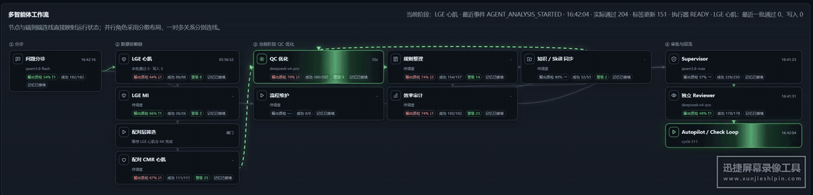
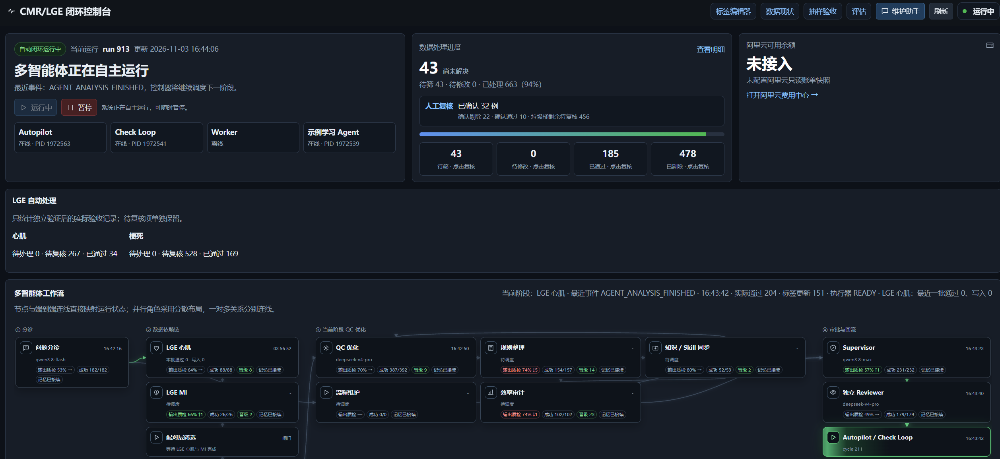
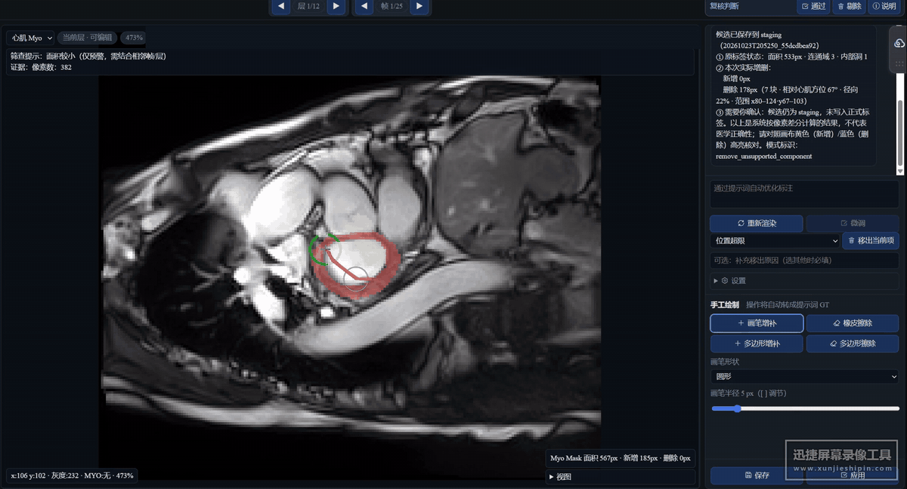

<div align="center">

# 🫀 CMR/LGE RSI

### 让人工经验，进入下一轮自动改进。

面向心脏 MRI 标签质控的 **可视化多智能体 · 持久经验 · 递归自我改进** 研究框架

[](https://github.com/Oubit1/cmr-lge-rsi/actions/workflows/ci.yml) [](LICENSE) [](requirements.txt) [](app/agent_continuity.py)

**简体中文** · [English](README.md)

[🎬 真实演示](#-看看它如何工作) · [✨ 主要特性](#-主要特性) · [🔁 RSI 机制](#-改进发生在哪里) · [🚀 快速开始](#-快速开始) · [📖 部署文档](docs/DEPLOYMENT.md)

</div>

[](https://github.com/Oubit1/cmr-lge-rsi/blob/main/docs/assets/workflow-demo.mp4)

<p align="center"><b>谁在工作、谁在等待、哪里需要改进，在同一张工作流上看见。</b></p>

## 为什么做这个项目？

医学图像标签修正中，一次有价值的人工判断往往可以帮助处理一类问题。我们希望把这份经验留下来：由专家 Agent 分析相似问题，提出工具或规则改进，再通过独立评审与固定基准决定能否用于后续样本。

**CMR/LGE RSI 把这条反馈链放进了一个可以看见、控制和追踪的工作台。** 人在编辑器中确认代表性样本；系统保存修正证据、执行结果与失败原因，供下一轮迭代继续使用。

## ✨ 主要特性

- **🧭 可视化多智能体控制台。** 节点、渐变状态与端到端连线展示角色关系，结合负责模型、耗时、最近事件和实际应用记录定位进度与故障。
- **🫀 面向 CMR / LGE 的专业分工。** 组织 LGE 心肌、梗死区域、配对层筛选与 CMR 心肌任务，保留模态、时间帧和空间层之间的依赖。
- **✍️ 人工反馈进入学习链。** 手工绘制、橡皮修正、提示词交互与确认结果在同一个编辑器内完成；已确认差分进入后续分析与知识积累。
- **🧠 更换模型，接续角色经验。** 角色记录、批准的工具、评审反馈和运行结果保存在本地；替换 API 时可以继续使用同一套职责与经验上下文。
- **🧪 有证据的工具与规则演化。** 改进在隔离快照中实现，比较候选与父版本的基准表现，记录晋级、保留父版本或退回修复的依据。
- **🎛️ 有界运行、可暂停、可回滚。** UI 控制服务，运行预算约束模型调用；执行结果保留源哈希、备份和审计，无法可靠处理的情况进入人工复核。

## 🎬 看看它如何工作

### 1. 一眼看见整个项目

运行状态、数据处理进度、待复核项和角色工作流集中在一页。展开细节前，先知道系统当前正在做什么。

[](docs/assets/console-ui.png)

### 2. 在标签编辑器中提供反馈

同一画面里查看影像与标签叠加、选择绘制工具、输入提示词，并确认修改。人工确认后的结果可进入持久反馈链，供后续专家和工具迭代使用。

[](https://github.com/Oubit1/cmr-lge-rsi/blob/main/docs/assets/editor-demo.mp4)

<sub>演示素材由项目作者提供。编辑器片段已裁掉病例列表、实色遮挡身份栏，并删除音轨与源元数据；录屏中的数字是该次界面状态，不是临床准确率或通用性能结论。</sub>

## 🔁 改进发生在哪里？

这个工程中的 RSI 对象是**工具、规则、Skill 与运行上下文**。每次候选改进都需要回答：改了什么、为什么改、是否优于父版本，以及能否在后续任务中复用。

| 环节 | 系统留下什么 | 下一轮如何使用 |
| --- | --- | --- |
| 问题分诊与专家分析 | 结构化证据、角色交接、相似问题线索 | 确定当前阶段与负责角色 |
| 人工复核与失败执行 | 确认差分、失败原因、执行回执 | 为新提案提供具体反馈 |
| 工具 / 规则 / Skill 改进 | 隔离源码快照、版本与来源 | 形成可比较的候选实现 |
| 独立评审与冻结基准 | 父子版本比较、非退化检查、评审结论 | 决定晋级、保留或修复 |
| 审计执行与经验积累 | 实际应用记录、收益归因、角色记忆 | 将本轮经验带到后续任务和替换后的模型 |

**数据依赖：** LGE 心肌 → LGE 梗死区域 → 配对层筛选 → 保留层的 CMR 心肌。就绪队列与逐例依赖检查共同决定执行顺序。

查看实现：[RSI 内核](app/rsi_kernel.py) · [角色记忆](app/agent_continuity.py) · [经验反馈](app/autonomy_feedback.py) · [执行控制](app/lge_execution.py)

## 🚀 快速开始

先体验一个**无需真实患者数据、无需 API Key** 的本地演示。

```bash
git clone https://github.com/Oubit1/cmr-lge-rsi.git
cd cmr-lge-rsi
python3 -m venv .venv
source .venv/bin/activate
pip install -r requirements.txt
python scripts/create_demo.py
python cli.py init
python scripts/board_server.py --port 8765
```

打开 [**本地控制台**](http://127.0.0.1:8765/)。进入 [标签编辑器演示](http://127.0.0.1:8765/editor?pool=cmr_middle_manifest&index=0&mode=manual) 查看几何合成样例。

推荐 **Linux / WSL + Python 3.10–3.12**。演示默认使用 mock 角色，自动执行关闭；接入真实工作流请继续阅读 [部署指南](docs/DEPLOYMENT.md)。

### 接入自己的模型和数据

1. 配置本地数据路径与有权限使用的医生审核图像 / 标签对。
2. 使用自己的数据重建校准、独立留出集和冻结基准。
3. 在 Provider 和角色配置中指定模型，凭据由本地环境变量提供。
4. 完成本地验证，安装对应服务，再从控制台显式启动有界工作流。

当前适配器包括 mock 与 **OpenAI-compatible Chat Completions**。其他协议可通过 Provider 层扩展，角色身份和持久经验仍由框架管理。

## 🧰 项目结构

```text
agents/       证据汇总 · 角色交接 · 独立评审
app/          状态机 · RSI 内核 · 经验记忆 · 执行控制
providers/    模型 API 适配
contracts/    结构化输入输出契约
scripts/      服务、评估与运行入口
static/       闭环控制台与标签编辑器
skills/       通用确定性 QC 工具与流程说明
experiments/  隔离实验和规则模块
tests/        合成数据回归测试
```

## ✅ 验证与复现

**1,900+ 回归测试**，GitHub CI 覆盖 Python 3.10 / 3.12；公开文件检查覆盖敏感文本、禁止发布的产物，以及逐字节绑定的已审阅媒体。

```bash
python -m unittest discover -s tests -q
python scripts/audit_public_tree.py
```

[查看 CI](https://github.com/Oubit1/cmr-lge-rsi/actions/workflows/ci.yml) · [验证记录](docs/VALIDATION.md)

<details>
<summary><b>发布范围与验证边界</b></summary>

公开版提供框架、通用工具、编辑器、配置模板和经过审阅的界面演示。原始医学数据、患者名单、医生参考标签、真实运行数据库、私有校准与基准资产、密钥和模型权重均不在仓库中。

软件回归通过不等于医学标注正确率，公开版也不宣称已证明持续的临床 RSI 性能提升。新的数据部署需要自己的校准与独立评估。完整说明见 [能力与限制](docs/STATUS.md)、[开源脱敏说明](docs/PUBLIC_RELEASE.md) 和 [安全说明](SECURITY.md)。

</details>

## 🤝 参与与交流

欢迎围绕角色分工、可复用工具、反馈学习、独立评估和可视化控制提出改进。复现问题请附**合成样例与脱敏信息**，参见 [贡献指南](CONTRIBUTING.md)。

相关开源项目：[FlashRSI](https://github.com/RUC-NLPIR/FlashRSI) — Agent 自我改进实验框架。

**MIT License** · [LICENSE](LICENSE) · [Issues](https://github.com/Oubit1/cmr-lge-rsi/issues)
